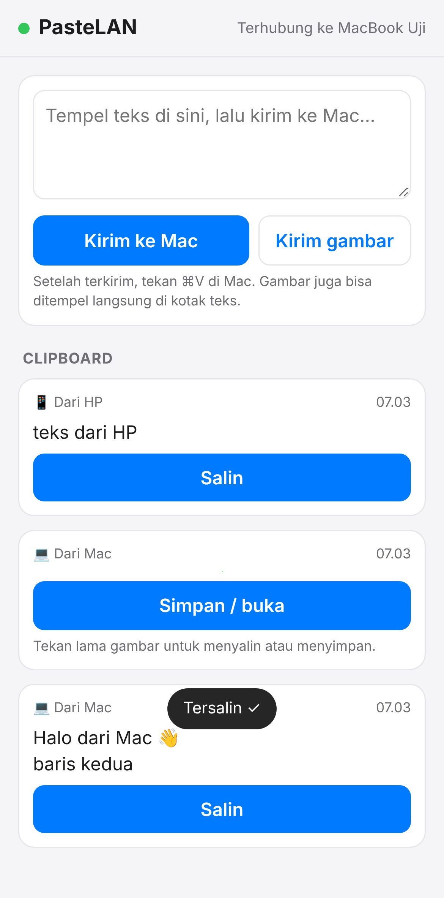
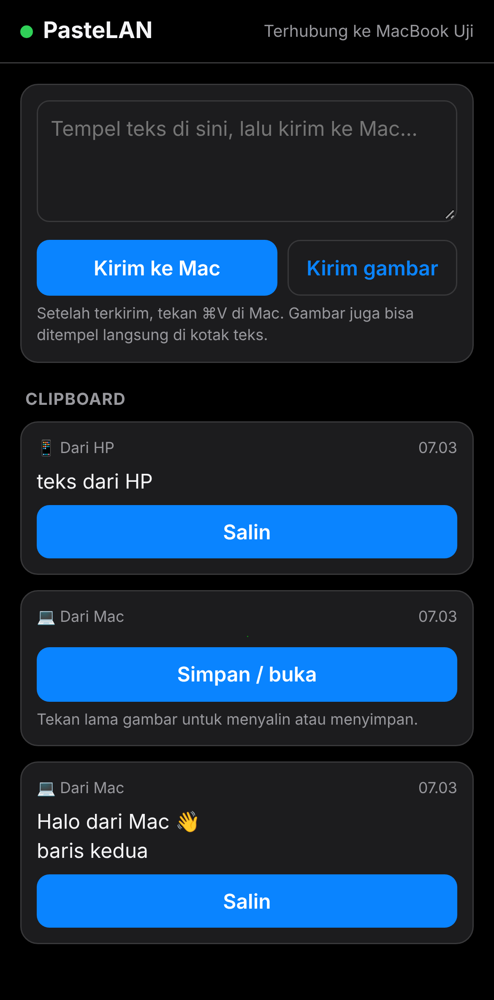

# PasteLAN

Aplikasi menu bar macOS **ringan** untuk berbagi **copy-paste teks & gambar** antara Mac dan HP
lewat **Wi-Fi yang sama**. Tanpa cloud, tanpa akun, dan **tanpa install aplikasi di HP**: cukup scan QR code.
Dibuat dengan Swift + AppKit + Network.framework murni, satu file sumber, tanpa dependensi.

```
 ┌──────── Mac ────────┐                  ┌──────── HP (browser) ────────┐
 │  ⌘C  ───────────────┼──── Wi-Fi ──────▶│  muncul otomatis → "Salin"   │
 │  ⌘V  ◀──────────────┼──── lokal ───────┤  tempel / pilih gambar → Kirim│
 └─────────────────────┘                  └──────────────────────────────┘
```

<p align="center">
  
  
</p>

## Fitur

- **HP → Mac**: tempel teks atau pilih gambar (bisa beberapa sekaligus), tekan **Kirim ke Mac**,
  lalu ⌘V di Mac. Gambar juga bisa ditempel langsung di kotak teks
- **Mac → HP**: setiap ⌘C di Mac (teks, screenshot, gambar dari browser, file gambar di Finder)
  **muncul otomatis** di halaman HP dalam ±1 detik. Tekan **Salin**, atau tekan lama gambar untuk menyalin/menyimpan
- Jalan di **iPhone & Android** (Safari, Chrome, dll.), bahkan di laptop lain
- **QR code langsung di menu**: tidak perlu mengetik alamat IP
- **Riwayat 20 item terakhir** di Mac & HP; klik item di menu Mac untuk menyalinnya lagi
- Mode **otomatis** atau **manual** ("Kirim clipboard Mac sekarang")
- Opsi menyimpan gambar dari HP ke folder **Unduhan**
- Ikon ✓ sebentar di menu bar saat menerima sesuatu dari HP
- Buka saat login, update dari menu, uninstall dari menu
- Hemat sumber daya: tanpa dependensi, clipboard dicek lewat satu angka (`changeCount`)

## Cara pakai

1. Pastikan Mac dan HP tersambung ke **Wi-Fi yang sama** (atau Mac memakai hotspot HP).
2. Klik ikon **⇄** di menu bar, lalu scan QR code dengan kamera HP. Halaman PasteLAN terbuka di browser.
   Simpan sebagai bookmark atau **Tambahkan ke Layar Utama** supaya tidak perlu scan lagi.
3. **HP → Mac**: tempel teks / pilih gambar, tekan **Kirim ke Mac**, lalu ⌘V di Mac.
4. **Mac → HP**: copy apa saja di Mac, isinya muncul di halaman HP.

### Izin & jaringan

- Kalau macOS bertanya **"Izinkan PasteLAN menerima koneksi masuk?"**, pilih **Izinkan**.
  Izin ini tetap berlaku setelah update karena aplikasi ditandatangani dengan identifier tetap.
- Wi-Fi **kantor / kampus / publik** sering memakai *client isolation* (antar-perangkat tidak bisa saling melihat).
  Kalau HP tidak bisa membuka halaman, pakai Wi-Fi rumah atau **hotspot HP**.
- Server memakai port **8787** (otomatis pindah ke 8788, 8789, … kalau sedang dipakai aplikasi lain).

### Keterbatasan

- Arah HP → Mac selalu butuh satu ketukan (**Kirim**): Android dan iOS tidak mengizinkan web/aplikasi
  membaca clipboard HP secara otomatis.
- Halaman HP harus terbuka supaya menerima item baru dari Mac (setelah dibuka lagi, item yang terlewat langsung muncul).
- Tombol **Salin** di HP memakai cara lama (`execCommand`) karena HTTP lokal bukan *secure context*. Gambar
  disalin dengan **tekan lama** gambar (menu bawaan iOS/Android).

## Privasi & keamanan

- Semua data hanya lewat **jaringan lokal**. Tidak ada server cloud, tidak ada analitik.
- **Terenkripsi ujung-ke-ujung**: QR code berisi **kunci acak 256-bit** di bagian `#k=` link (bagian ini tidak
  pernah dikirim lewat jaringan). Semua teks, gambar, daftar riwayat, dan nama Mac dienkripsi **ChaCha20-Poly1305**
  (CryptoKit di Mac, JS bawaan halaman di HP). Penyadap di Wi-Fi yang sama hanya melihat ukuran & waktu, tidak bisa
  membaca isi, memalsukan, atau mengulang request. **Ganti link** di menu memutus semua HP yang pernah terhubung.
- Riwayat **hanya disimpan di memori** dan hilang saat PasteLAN ditutup.
- Isi dari **password manager** (bertanda `org.nspasteboard.ConcealedType`) **tidak pernah** dikirim ke HP.
- Hanya perangkat di **jaringan lokal** yang dilayani (koneksi dari VPN / IP publik ditolak). Kunci dicek sebelum
  isi request dibaca, dan tiap perangkat dibatasi jumlah koneksinya, supaya perangkat lain tidak bisa membebani Mac.
- Saat pertama kali dibuka, PasteLAN **bertanya** apakah setiap copy di Mac boleh dikirim otomatis ke HP.
- **Salin link** tidak ikut Universal Clipboard ke perangkat Apple lain dan ditandai rahasia untuk clipboard manager.
- Batasan: halamannya sendiri tetap dimuat lewat HTTP. Penyerang **aktif** di Wi-Fi yang sama (mis. ARP spoofing)
  secara teori bisa mengganti halaman itu untuk mencuri kunci. Di Wi-Fi publik yang tidak dipercaya, lebih aman
  memakai hotspot HP sendiri, dan tekan **Ganti link** kalau ragu.
- **Update otomatis** hanya dipasang kalau file rilis cocok dengan tanda tangan Ed25519 pemilik repo
  (lihat [Rilis](#rilis)). Kalau tidak, PasteLAN hanya membuka halaman rilis.
- Matikan **Berbagi aktif** di menu kapan saja untuk menutup port.

## Instal

Unduh dari [Releases](https://github.com/kikiraihan/mac-os-PasteLAN/releases/latest):

- **`PasteLAN.zip`**: ekstrak, pindahkan `PasteLAN.app` ke **Applications**, lalu buka.
  Kalau macOS menolak membuka (aplikasi belum dinotarisasi): klik kanan → **Open**, atau jalankan
  `xattr -cr /Applications/PasteLAN.app`.
- **`install-PasteLAN.zip`**: ekstrak, lalu jalankan `bash install-PasteLAN.command`
  (compile di Mac Anda, butuh Xcode Command Line Tools).

Butuh **macOS 13 (Ventura)** atau lebih baru.

## Build sendiri

```bash
xcode-select --install   # sekali saja
./scripts/build.sh       # hasil: build/PasteLAN.app
cp -R build/PasteLAN.app /Applications/ && open /Applications/PasteLAN.app
```

## Cara kerja (singkat)

| Bagian | Teknologi |
|---|---|
| Server HTTP | `NWListener` (Network.framework), parser HTTP/1.1 minimal |
| Mac → HP real-time | Long-polling (`GET /api/items?wait=1`, ditahan maks 25 detik) |
| Enkripsi | ChaCha20-Poly1305: header `X-Auth` sekali pakai + isi & jawaban terenkripsi, kunci di `#k=` |
| Pantau clipboard | `NSPasteboard.changeCount` tiap 0,8 detik |
| QR code | CoreImage `CIQRCodeGenerator` |
| Halaman HP | HTML/CSS/JS ditanam di aplikasi, tanpa CDN (jalan tanpa internet) |

Rencana pengembangan ada di [`_todo/`](_todo/), ide lanjutan (aplikasi native di HP) di [`_techdebt/`](_techdebt/).

## Rilis

Versi diatur di `Resources/Info.plist` (lihat [AGENTS.md](AGENTS.md)). Merge ke `main` dengan versi yang belum
punya tag akan otomatis membuat tag `v<versi>` dan rilis lewat GitHub Actions.

### Tanda tangan rilis (auto-update)

Auto-update di aplikasi hanya memasang `PasteLAN.zip` yang punya `PasteLAN.zip.sig` valid untuk kunci publik di
`Updater.publicKey`. Yang ditandatangani: `"PasteLAN <tag>\n"` + isi zip (Ed25519, `scripts/sign-release.swift`).

1. Sekali saja, di Mac sendiri: `swift scripts/sign-release.swift keygen` → kunci privat di `~/.pastelan-signing-key`,
   kunci publik tercetak di terminal → tempel ke `Updater.publicKey` di `main.swift`.
2. Pilih cara menandatangani:
   - **Otomatis (CI)**: simpan isi `~/.pastelan-signing-key` sebagai GitHub Secret `PASTELAN_SIGNING_KEY`.
     Melindungi dari aset rilis yang diganti, tapi **tidak** dari akun GitHub yang dibobol (pembobol bisa memakai
     secret lewat workflow).
   - **Manual (lebih aman)**: jangan simpan secret. Setelah rilis jadi, di Mac sendiri:
     `swift scripts/sign-release.swift sign PasteLAN.zip v<versi> > PasteLAN.zip.sig`, lalu unggah `PasteLAN.zip.sig`
     ke halaman rilis. Kunci privat tidak pernah meninggalkan Mac Anda.
